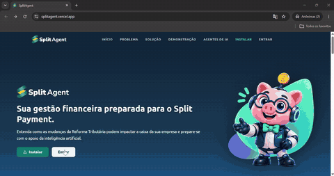
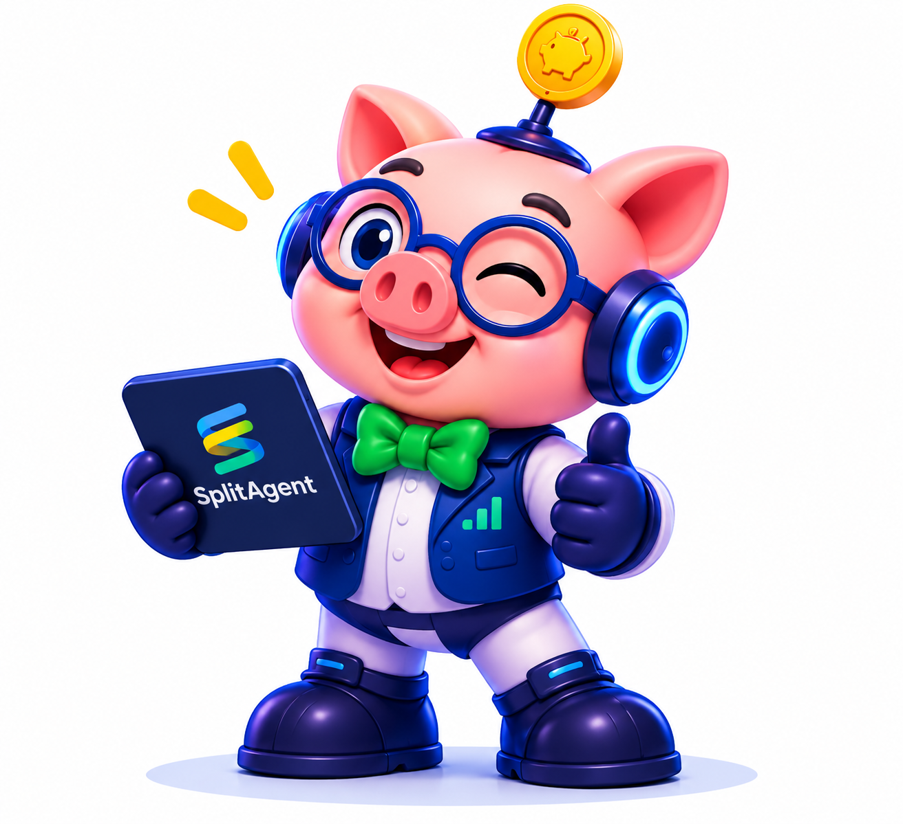
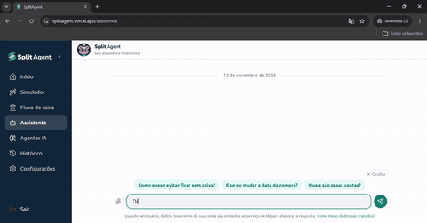
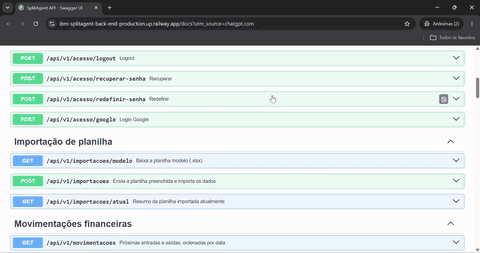
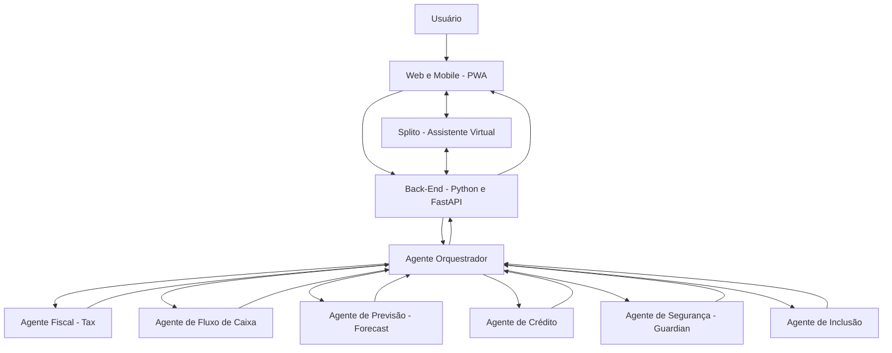
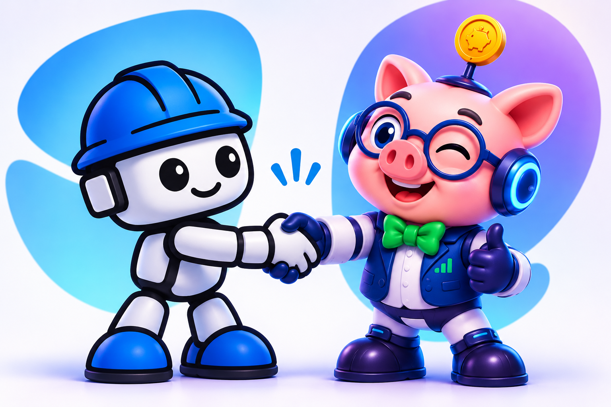

# SplitAgent — Inteligência Financeira Agêntica

## Nosso Time

<table>
<tr>
<td align="center" valign="top" width="25%">
<a href="https://github.com/Tiasgod"> <strong>Tiago Dias</strong></a> 
Líder da equipe 
Back-End  

</td>

<td align="center" valign="top" width="25%">
<a href="https://github.com/juliana15paak"> <strong>Juliana Alves</strong></a> 
Designer da Solução 
UI/UX  

</td>

<td align="center" valign="top" width="25%">
<a href="https://github.com/VitoriaAmelia"> <strong>Vitoria Amelia</strong></a> 
Líder de Pesquisa 
Front-End  

</td>

<td align="center" valign="top" width="25%">
<a href="https://github.com/Rafa15MQS"> <strong>Rafaela Marques</strong></a> 
Líder Técnica 
Líder de Comunicação  

</td>
</tr>
</table>

A **ThreeValley** é uma equipe formada por profissionais em desenvolvimento de software, inteligência artificial, design e pesquisa, unida pelo propósito de transformar desafios financeiros em soluções tecnológicas inteligentes.

Somos responsáveis pelo **SplitAgent**, uma plataforma de inteligência financeira que combina agentes autônomos de IA, automação e análise de dados para simplificar a gestão empresarial. Nossa solução conecta diferentes atividades financeiras em um único ambiente, com destaque para o Split Payment, o acompanhamento do fluxo de caixa e o apoio à tomada de decisões.

Mais do que desenvolver uma aplicação, buscamos aproximar a inteligência artificial das necessidades reais dos empreendedores, oferecendo uma experiência acessível tanto pela Web quanto por dispositivos móveis.

### Mentoria

- Silas Fernandes
- João Carlos Manozzo Junior

### Persona

- **Priscila Araújo — Contadora profissional**

## Sumário

- [Sobre o projeto](#sobre-o-projeto)
- [A proposta](#a-proposta)
- [O problema](#o-problema)
- [Objetivos](#objetivos)
- [Agentes de IA](#agentes-de-ia)
- [Funcionalidades](#funcionalidades)
- [API](#api)
- [Arquitetura da solução](#arquitetura-da-solução)
- [Tecnologias utilizadas](#tecnologias-utilizadas)
- [IBM Bob](#ibm-bob)
- [Comunicação entre Front-End e Back-End](#comunicação-entre-front-end-e-back-end)
- [Segurança e governança](#segurança-e-governança)
- [Diferenciais](#diferenciais)
- [Agradecimentos](#agradecimentos)
- [Contexto do projeto](#contexto-do-projeto)
- [Impacto e contribuição](#impacto-e-contribuição)
- [Licença](#licença)

## Sobre o projeto

O **SplitAgent** é uma plataforma de inteligência financeira baseada em uma arquitetura de múltiplos agentes de inteligência artificial, desenvolvida para auxiliar empresas e empreendedores na organização de suas finanças, na divisão de pagamentos e no acompanhamento do fluxo de caixa.

Um dos principais pilares da solução é o **Split Payment**, modelo que permite distribuir automaticamente os valores de uma transação entre diferentes destinatários, considerando as regras e condições estabelecidas para cada operação.

Além da divisão de pagamentos, a plataforma reúne recursos de análise financeira, previsão de caixa, informações fiscais, avaliação de crédito e segurança. Os agentes especializados trabalham de maneira integrada, permitindo que diferentes aspectos de uma operação financeira sejam analisados em conjunto.

O SplitAgent também considera as transformações do cenário tributário brasileiro, especialmente as mudanças introduzidas pela Reforma Tributária. Por meio de seus recursos de análise fiscal e inteligência artificial, a solução oferece suporte à compreensão de novas regras, à organização de informações tributárias e à avaliação de seus possíveis impactos nas operações empresariais.

Sua estrutura permite acompanhar mudanças na legislação e adaptar suas análises conforme novas regras tributárias entram em vigor, contribuindo para que os empreendedores tenham mais clareza sobre suas obrigações e decisões financeiras.

A plataforma está disponível em **duas modalidades de acesso:**

- **Web:** acesso pelo navegador, com interface adaptada para computadores.
- **Mobile:** experiência otimizada para dispositivos móveis.

As duas experiências utilizam a tecnologia **PWA (Progressive Web App)**, proporcionando uma aplicação multiplataforma, com possibilidade de instalação nos dispositivos compatíveis.

### Demonstração da plataforma

  

## A proposta

O SplitAgent utiliza inteligência artificial agêntica para simplificar atividades financeiras, tendo como um de seus principais focos o **Split Payment**.

Esse modelo de pagamento permite que os valores de uma transação sejam distribuídos diretamente entre os participantes envolvidos, de acordo com as regras da operação. Isso contribui para uma gestão mais organizada dos recebimentos e para a integração dos processos financeiros.

A solução reúne agentes especializados em diferentes áreas, coordenados por um agente orquestrador responsável por interpretar as solicitações e direcioná-las aos componentes adequados.

Além da distribuição de pagamentos, o sistema integra análise de fluxo de caixa, previsão financeira, crédito, aspectos fiscais, segurança e inclusão financeira.

Outro ponto importante é a capacidade de acompanhar as transformações da legislação tributária. Com a implementação da Reforma Tributária e a chegada de novas regras, empresas precisam compreender mudanças que podem afetar seus processos, custos e obrigações.

Nesse contexto, o SplitAgent utiliza sua estrutura de inteligência artificial para auxiliar na interpretação dessas informações e apoiar a avaliação de cenários, contribuindo para uma gestão mais preparada diante das mudanças tributárias.

## O problema

A gestão financeira pode ser desafiadora para empresas que precisam controlar entradas e saídas, organizar pagamentos, acompanhar obrigações fiscais e prever necessidades futuras de caixa.

A falta de integração entre essas atividades dificulta a análise das informações e pode tornar a tomada de decisões mais lenta.

O cenário também se torna mais complexo diante das mudanças na legislação tributária brasileira. Novas regras podem exigir adaptações nos processos financeiros, na organização dos pagamentos e no acompanhamento das obrigações fiscais.

O SplitAgent enfrenta esses desafios por meio da inteligência artificial agêntica, reunindo recursos que auxiliam na organização das transações, na conferência de valores, na análise financeira e na compreensão de informações tributárias.

Com isso, a plataforma oferece um ambiente integrado para tornar os processos mais organizados, transparentes e eficientes.

## Objetivos

### Objetivo geral

Oferecer uma solução baseada em inteligência artificial agêntica para auxiliar empresas na divisão de pagamentos, na gestão do fluxo de caixa e na análise de informações financeiras e fiscais.

### Objetivos específicos

- Automatizar tarefas relacionadas à organização financeira.
- Auxiliar no acompanhamento das entradas e saídas de recursos.
- Gerar previsões para apoiar o planejamento do fluxo de caixa.
- Apoiar análises relacionadas a crédito e aspectos fiscais.
- Facilitar a compreensão de informações relacionadas às mudanças tributárias.
- Integrar agentes especializados por meio de um agente orquestrador.
- Considerar segurança, governança e inclusão financeira.
- Disponibilizar uma experiência multiplataforma, com acesso Web e Mobile.

## Agentes de IA

O SplitAgent utiliza uma arquitetura composta por agentes especializados. Cada agente possui uma responsabilidade específica e trabalha de forma integrada com os demais por meio do agente orquestrador.

### 1. Orquestrador

Responsável por coordenar a comunicação entre os agentes, interpretar as solicitações recebidas e direcionar cada tarefa ao agente especializado adequado.

### 2. Agente Fiscal — Tax

Voltado à análise de informações fiscais e ao apoio na organização de obrigações relacionadas a impostos e tributos. Também auxilia na compreensão das mudanças na legislação tributária, incluindo as transformações decorrentes da Reforma Tributária brasileira.

### 3. Agente de Fluxo de Caixa — Cash Flow

Responsável por auxiliar no acompanhamento das entradas e saídas financeiras, contribuindo para uma visão organizada da situação financeira da empresa.

### 4. Agente de Previsão — Forecast

Utiliza os dados financeiros disponíveis para analisar tendências, projetar cenários futuros e identificar possíveis necessidades de planejamento.

### 5. Agente de Crédito — Credit

Voltado ao apoio na análise de informações financeiras relacionadas ao crédito, contribuindo para uma avaliação mais organizada dos dados disponíveis.

### 6. Agente de Segurança — Guardian

Tem como foco os aspectos de segurança, monitoramento e proteção das informações utilizadas pelo sistema.

### 7. Agente de Inclusão — Inclusion

Busca considerar a acessibilidade e a inclusão financeira, contribuindo para que a solução seja mais compreensível e acessível aos seus usuários.

### 8. Splito — Assistente Virtual

  

O **Splito** é o assistente virtual do SplitAgent, desenvolvido para proporcionar uma interação mais simples e intuitiva com a plataforma.

Por meio de uma comunicação conversacional, ele permite que os usuários façam perguntas, esclareçam dúvidas e compreendam melhor os recursos e as informações disponibilizadas pelo sistema.

Entre suas principais funções estão:

- Conversar com os usuários de maneira natural.
- Explicar funcionalidades e recursos da plataforma.
- Responder dúvidas sobre o funcionamento do SplitAgent.
- Auxiliar na compreensão de informações financeiras.
- Orientar os usuários durante a utilização do sistema.

O Splito aproxima a inteligência artificial do usuário, tornando a experiência de utilização mais acessível e interativa.

  

## Funcionalidades

O SplitAgent reúne funcionalidades voltadas à gestão financeira e à utilização de inteligência artificial em processos empresariais.

- **Split Payment:** apoio à organização e à distribuição de pagamentos entre diferentes destinatários.
- **Gestão financeira:** acompanhamento e organização de informações financeiras.
- **Análise do fluxo de caixa:** visualização das entradas e saídas de recursos.
- **Previsão financeira:** análise de tendências e projeção de cenários futuros.
- **Análise fiscal:** suporte à organização e à compreensão de informações tributárias.
- **Reforma Tributária:** apoio à compreensão de mudanças nas regras fiscais e à avaliação de seus possíveis impactos nas operações empresariais.
- **Análise de crédito:** apoio à avaliação de informações financeiras.
- **Assistente virtual Splito:** interação conversacional para explicações e esclarecimento de dúvidas.
- **Orquestração de agentes:** encaminhamento de solicitações para agentes especializados.
- **Segurança:** mecanismos de proteção e controle das informações.
- **Acessibilidade:** atenção à inclusão e à facilidade de utilização.
- **Acesso multiplataforma:** utilização da aplicação pela Web e por dispositivos móveis.

## API

A comunicação entre os componentes do sistema é realizada por meio de uma API desenvolvida com FastAPI.

**Documentação interativa:**

https://ibm-splitagent-back-end-production.up.railway.app/docs#/

  

## Arquitetura da solução

A arquitetura do SplitAgent separa a interface do usuário, a camada de serviços, o armazenamento de dados e a lógica de inteligência artificial.

A aplicação oferece acesso Web e Mobile por meio de uma estrutura PWA. O Back-End utiliza Python e FastAPI para disponibilizar os endpoints, processar as solicitações e integrar os diferentes componentes do sistema.

A camada de inteligência artificial é organizada em agentes especializados, coordenados pelo orquestrador. O Splito também integra essa experiência, oferecendo uma interface conversacional para interação com os usuários.

O fluxo representa a integração entre as plataformas, a API, os agentes especializados e o assistente virtual, demonstrando como os diferentes componentes trabalham em conjunto para atender às solicitações dos usuários.

## Tecnologias utilizadas

### Front-End e plataformas

- **Web:** interface acessível por navegadores, com experiência adaptada para computadores.
- **Mobile:** aplicação otimizada para utilização em dispositivos móveis.
- **PWA (Progressive Web App):** tecnologia que proporciona uma experiência multiplataforma, permitindo a instalação da aplicação em dispositivos compatíveis.
- **React:** biblioteca utilizada na construção das interfaces.
- **JavaScript:** linguagem utilizada na implementação dos recursos e da interação da aplicação.

### Back-End

- **Python:** linguagem utilizada na construção dos serviços e da lógica do sistema.
- **FastAPI:** framework utilizado na criação da API e na integração entre os componentes.
- **PostgreSQL:** banco de dados relacional utilizado para armazenar as informações da aplicação.
- **SQLAlchemy:** ferramenta utilizada no mapeamento e na interação com o banco de dados.
- **Alembic:** ferramenta de gerenciamento das migrações do banco de dados.

### Inteligência artificial

- **Arquitetura multiagente:** organização da inteligência artificial em agentes especializados.
- **Agente Orquestrador:** coordenação e encaminhamento das solicitações.
- **IBM Watson:** tecnologia do ecossistema IBM utilizada como parte dos recursos de inteligência artificial.
- **Splito:** assistente virtual conversacional integrado à plataforma.
- **Cloudflare:** tecnologia utilizada no ecossistema de infraestrutura e proteção da aplicação.

### Infraestrutura e hospedagem

- **Vercel:** hospedagem e disponibilização da aplicação Front-End.
- **Railway:** hospedagem dos serviços de Back-End e API.
- **Neon:** serviço de banco de dados PostgreSQL.
- **Cloudflare:** recursos de infraestrutura e proteção associados à aplicação.

### Ferramentas de desenvolvimento

- **IBM Bob:** ferramenta de apoio às atividades de desenvolvimento de software.
- **Git e GitHub:** controle de versão, organização e colaboração no código-fonte.

## IBM Bob

O **IBM Bob** foi utilizado como ferramenta de apoio durante a construção do SplitAgent.

A ferramenta auxiliou a equipe em atividades relacionadas ao desenvolvimento de software, como programação, análise de código, depuração, organização e aprimoramento dos componentes técnicos.

Sua utilização contribuiu para otimizar o trabalho da equipe e explorar novas possibilidades de aplicação da inteligência artificial no processo de desenvolvimento.

## Comunicação entre Front-End e Back-End

A comunicação entre a interface e o Back-End ocorre por meio de uma API desenvolvida com FastAPI.

As aplicações Web e Mobile enviam requisições HTTP aos endpoints disponibilizados pelo servidor. O Back-End processa as solicitações, executa as regras correspondentes, aciona os agentes especializados quando necessário e retorna os resultados para a interface.

Esse modelo mantém a interface separada das regras de negócio e permite a integração organizada entre os diferentes componentes da aplicação.

### Fluxo de comunicação

1. O usuário realiza uma solicitação pela interface Web ou Mobile.
2. O Front-End envia a requisição para a API.
3. O Back-End recebe e processa a solicitação.
4. O orquestrador direciona a tarefa ao agente especializado, quando necessário.
5. O agente executa a análise correspondente.
6. O resultado retorna pelo Back-End.
7. A interface apresenta as informações ao usuário.

## Segurança e governança

A segurança e a governança são aspectos importantes para uma solução que trabalha com informações financeiras.

O SplitAgent considera mecanismos e práticas voltados a:

- Proteção das informações dos usuários.
- Controle de acesso aos recursos da aplicação.
- Validação dos dados recebidos pela API.
- Tratamento de erros e solicitações inválidas.
- Privacidade e uso responsável da inteligência artificial.
- Avaliação das respostas produzidas pelos agentes.
- Rastreabilidade e confiabilidade das informações.
- Proteção da comunicação entre os componentes do sistema.

## Diferenciais

- **Split Payment:** foco na organização e na distribuição de pagamentos entre diferentes destinatários.
- **Arquitetura multiagente:** agentes especializados em diferentes áreas financeiras.
- **Splito:** assistente virtual que conversa, explica e esclarece dúvidas dos usuários.
- **Inteligência financeira integrada:** combinação de análise, organização e previsão financeira.
- **Acompanhamento tributário:** suporte à compreensão de mudanças na legislação e de seus possíveis impactos.
- **Acesso multiplataforma:** disponibilidade de experiências Web e Mobile utilizando PWA.
- **Orquestração inteligente:** coordenação das solicitações por um agente central.
- **Inclusão financeira:** atenção à acessibilidade e à facilidade de utilização.
- **Parceria e inovação:** solução desenvolvida no contexto da colaboração com a IBM e o Banco do Brasil.

## Agradecimentos

Agradecemos à **IBM** pela oportunidade de participar dessa iniciativa, pelo contato com novas tecnologias e pelo incentivo à construção de soluções inovadoras.

Agradecemos também ao **Banco do Brasil** pela parceria e pelo contexto de aplicação que contribuiu para a construção do SplitAgent.

Um agradecimento especial aos nossos mentores, **Silas Fernandes** e **João Carlos Manozzo Junior**, pelas orientações e contribuições ao longo da jornada.

Agradecemos ainda à **Priscila Araújo**, contadora profissional, pela contribuição como referência para a compreensão das necessidades e dos desafios relacionados à área contábil.

Por fim, agradecemos a todos que contribuíram para essa experiência de aprendizado, colaboração e inovação.

  

## Contexto do projeto

O SplitAgent é uma solução desenvolvida pela equipe **ThreeValley** no contexto de uma iniciativa de inovação em parceria com a IBM e o Banco do Brasil.

A proposta reúne conhecimentos de desenvolvimento de software, inteligência artificial, organização financeira e experiência do usuário para solucionar desafios reais enfrentados por empresas e empreendedores.

O projeto representa a aplicação prática de tecnologias emergentes em um cenário de transformação digital, com foco na inteligência artificial agêntica e em sua utilização para aprimorar processos financeiros.

## Impacto e contribuição

O SplitAgent busca contribuir para uma gestão financeira mais organizada, integrada e inteligente.

Ao reunir divisão de pagamentos, acompanhamento de caixa, previsões financeiras e análise fiscal, a plataforma oferece recursos que auxiliam os empreendedores na compreensão de suas operações e na tomada de decisões.

Seu foco no Split Payment ganha ainda mais relevância diante das transformações do sistema tributário brasileiro. A Reforma Tributária representa mudanças importantes para empresas de diferentes segmentos, exigindo atenção às novas regras, aos processos de recolhimento de tributos e aos impactos financeiros das operações.

Nesse cenário, o SplitAgent reúne inteligência artificial e análise financeira para auxiliar os usuários a compreender essas transformações, organizar informações e avaliar diferentes cenários.

Mais do que acompanhar as necessidades atuais das empresas, a solução possui uma estrutura de agentes especializados que permite incorporar novos contextos de análise, acompanhando a evolução das demandas financeiras e tributárias.

# Licença

Este projeto está licenciado sob a **Licença MIT**.

Copyright (c) 2026 ThreeValley.
