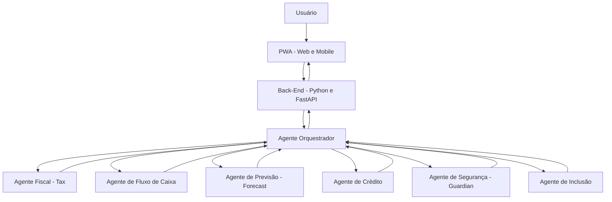

# SplitAgent — Inteligência Financeira Agêntica

## Nosso Time

<table>
<tr>
<td align="center" valign="top" width="25%">
<a href="https://github.com/Tiasgod"> <strong>Tiago Dias</strong></a> 
Líder da equipe 
Back-End  

</td>

<td align="center" valign="top" width="25%">
<a href="https://github.com/juliana15paak"> <strong>Juliana Alves</strong></a> 
Designer da Solução 
UI/UX  

</td>

<td align="center" valign="top" width="25%">
<a href="https://github.com/VitoriaAmelia"> <strong>Vitoria Amelia</strong></a> 
Líder de Pesquisa 
Front-End  

</td>

<td align="center" valign="top" width="25%">
<a href="https://github.com/Rafa15MQS"> <strong>Rafaela Marques</strong></a> 
Líder Técnica 
Líder de Comunicação  

</td>
</tr>
</table>

A ThreeValley é a equipe responsável pelo desenvolvimento do SplitAgent, reunindo diferentes competências em desenvolvimento de software, inteligência artificial, design e pesquisa.

Nosso objetivo é desenvolver uma solução tecnológica que utilize agentes de inteligência artificial para apoiar empreendedores na análise financeira e na tomada de decisões, explorando novas possibilidades de aplicação da IA em problemas reais.

### Mentoria

- Silas Fernandes
- João Carlos Manozzo Junior
## Sumário

- [Quem somos](#quem-somos)
- [Sobre o projeto](#sobre-o-projeto)
- [A proposta](#a-proposta)
- [O problema](#o-problema)
- [Objetivos](#objetivos)
- [Agentes de IA](#agentes-de-ia)
- [Funcionalidades](#funcionalidades)
- [Arquitetura da solução](#arquitetura-da-solução)
- [Tecnologias utilizadas](#tecnologias-utilizadas)
- [IBM Bob](#ibm-bob)
- [Comunicação entre Front-End e Back-End](#comunicação-entre-front-end-e-back-end)
- [Segurança e governança](#segurança-e-governança)
- [Diferenciais](#diferenciais)
- [Roadmap](#roadmap)
- [Agradecimentos](#agradecimentos)
- [Contexto do projeto](#contexto-do-projeto)
- [Impacto esperado](#impacto-esperado)
- [Licença](#licença)

## Sobre o projeto

O **SplitAgent** é uma solução de inteligência financeira baseada em uma arquitetura de múltiplos agentes de inteligência artificial. O projeto tem como objetivo auxiliar empresas na organização de suas finanças, na divisão de pagamentos e no acompanhamento do fluxo de caixa.

A solução utiliza agentes especializados que trabalham de forma integrada, permitindo analisar diferentes aspectos financeiros e contribuir para uma tomada de decisão mais organizada e eficiente.

O sistema está sendo desenvolvido com uma aplicação web responsiva no formato **PWA (Progressive Web App)**, permitindo o acesso por navegadores em computadores e dispositivos móveis.

## A proposta

O SplitAgent propõe utilizar inteligência artificial agêntica para simplificar e automatizar processos financeiros, tendo como foco principal o Split Payment, um modelo de pagamento que permite dividir automaticamente os valores de uma transação entre diferentes destinatários.

A solução utiliza agentes de inteligência artificial especializados em diferentes atividades, coordenados por um agente orquestrador responsável por direcionar as demandas e integrar as informações.

Com foco no Split Payment, o sistema busca auxiliar na organização e na divisão dos valores de cada transação, considerando os participantes envolvidos e as regras definidas para a operação. Além disso, integra recursos de análise financeira, previsão de caixa, avaliação de crédito, aspectos fiscais, segurança e inclusão financeira em um único ambiente.

Dessa forma, o SplitAgent busca tornar o gerenciamento das transações mais organizado, transparente e eficiente, apoiando a tomada de decisões e reduzindo a necessidade de atividades manuais.

## O problema

A gestão de pagamentos pode ser complexa para empresas que precisam dividir os valores de uma mesma transação entre diferentes destinatários, controlar os repasses e acompanhar as informações financeiras e fiscais relacionadas a cada operação.

Quando esse processo é realizado manualmente ou por meio de sistemas pouco integrados, podem ocorrer dificuldades na conferência dos valores, atrasos nos repasses, erros na distribuição dos recursos e problemas no acompanhamento das transações.

Além disso, a falta de integração entre pagamentos, controle financeiro e obrigações fiscais pode dificultar a identificação de inconsistências e tornar a tomada de decisões mais lenta.

O SplitAgent busca enfrentar esses desafios por meio da inteligência artificial agêntica, utilizando agentes especializados para apoiar o processo de Split Payment, organizar as informações das transações, auxiliar na conferência dos valores e identificar possíveis inconsistências. A proposta é oferecer uma solução integrada que contribua para tornar a divisão dos pagamentos mais segura, organizada e eficiente.

## Objetivos

### Objetivo geral

Desenvolver uma solução baseada em inteligência artificial agêntica para auxiliar na divisão de pagamentos, na gestão do fluxo de caixa e na análise de informações financeiras.

### Objetivos específicos

- Automatizar tarefas relacionadas à organização financeira.
- Auxiliar no acompanhamento das entradas e saídas de recursos.
- Gerar previsões para apoiar o planejamento do fluxo de caixa.
- Apoiar análises relacionadas a crédito e aspectos fiscais.
- Integrar agentes especializados por meio de um agente orquestrador.
- Considerar segurança, governança e inclusão financeira durante o desenvolvimento.
- Disponibilizar uma interface acessível pela web e por dispositivos móveis.

## Agentes de IA

O SplitAgent utiliza uma arquitetura composta por agentes especializados. Cada agente possui uma responsabilidade específica e pode colaborar com os demais por meio do agente orquestrador.

### 1. Orquestrador

Responsável por coordenar a comunicação entre os agentes, interpretar as solicitações recebidas e direcionar cada tarefa para o agente especializado adequado.

### 2. Agente Fiscal — Tax

Voltado à análise de informações fiscais e ao apoio na organização de obrigações relacionadas a impostos e tributos.

### 3. Agente de Fluxo de Caixa — Cash Flow

Responsável por auxiliar no acompanhamento das entradas e saídas financeiras, contribuindo para uma visão organizada da situação financeira.

### 4. Agente de Previsão — Forecast

Utiliza os dados financeiros disponíveis para apoiar a previsão de cenários futuros e identificar possíveis necessidades de planejamento.

### 5. Agente de Crédito — Credit

Voltado ao apoio na análise de informações financeiras relacionadas ao crédito, contribuindo para uma avaliação mais organizada dos dados disponíveis.

### 6. Agente de Segurança — Guardian

Tem como foco os aspectos de segurança, monitoramento e proteção das informações utilizadas pelo sistema.

### 7. Agente de Inclusão — Inclusion

Busca considerar a acessibilidade e a inclusão financeira, contribuindo para que a solução seja mais compreensível e acessível aos seus usuários.

## Funcionalidades

Entre as funcionalidades previstas para o SplitAgent estão:

- **Divisão de pagamentos:** apoio à organização e à distribuição de pagamentos.
- **Gestão financeira:** acompanhamento de entradas e saídas de recursos.
- **Análise do fluxo de caixa:** organização das informações financeiras.
- **Previsão financeira:** apoio à identificação de tendências e necessidades futuras.
- **Análise fiscal:** suporte à organização de informações relacionadas a obrigações fiscais.
- **Análise de crédito:** apoio à avaliação de informações financeiras.
- **Orquestração de agentes:** encaminhamento de solicitações para agentes especializados.
- **Segurança:** consideração de mecanismos de proteção e controle das informações.
- **Acessibilidade:** atenção à inclusão e à facilidade de utilização da plataforma.
- **Acesso multiplataforma:** utilização da aplicação por navegadores em computadores e dispositivos móveis.

As funcionalidades representam o escopo planejado para a solução e poderão ser implementadas e refinadas ao longo do desenvolvimento.

## API

https://ibm-splitagent-back-end-production.up.railway.app/docs#/

## Arquitetura da solução

A arquitetura do SplitAgent foi pensada para separar a interface do usuário, a camada de serviços e a lógica de inteligência artificial.

A aplicação será disponibilizada como uma **PWA**, permitindo acesso pela web e por dispositivos móveis. O Back-End será desenvolvido em Python utilizando FastAPI, responsável por disponibilizar os endpoints e intermediar as solicitações da aplicação.

A camada de inteligência artificial será organizada em agentes especializados, coordenados pelo orquestrador.

O fluxo apresentado representa a arquitetura conceitual da solução. A comunicação e a integração definitivas entre os componentes dependem da implementação técnica do projeto.

## Tecnologias utilizadas

### Front-End

- **PWA (Progressive Web App):** aplicação acessível por navegadores e dispositivos móveis.
- **Tecnologias web:** utilizadas na construção da interface e da experiência do usuário.

### Back-End

- **Python:** linguagem utilizada no desenvolvimento dos serviços.
- **FastAPI:** framework para criação de APIs e integração entre os componentes do sistema.

### Inteligência artificial

- **Arquitetura multiagente:** organização da solução em agentes especializados.
- **Agente orquestrador:** coordenação e encaminhamento das solicitações.
- **IBM Bob:** ferramenta utilizada como apoio durante o desenvolvimento.

## IBM Bob

O **IBM Bob** foi utilizado como ferramenta de apoio durante o desenvolvimento do projeto SplitAgent.

A ferramenta auxilia atividades de desenvolvimento de software, contribuindo para tarefas como programação, análise de código, depuração e organização do trabalho técnico.

Sua utilização faz parte da experiência de desenvolvimento da equipe, apoiando a construção e o aprimoramento da solução.

## Comunicação entre Front-End e Back-End

A comunicação entre a interface e o Back-End será realizada por meio de uma API desenvolvida com FastAPI.

A aplicação PWA enviará requisições HTTP aos endpoints disponibilizados pelo servidor. O Back-End será responsável por processar as solicitações, acionar a lógica correspondente e retornar as respostas para a interface.

Esse modelo permite manter a interface separada das regras de negócio e facilita a integração entre os diferentes componentes da aplicação.

Exemplo conceitual de fluxo:

1. O usuário realiza uma solicitação pela interface.
2. O Front-End envia a requisição para a API.
3. O Back-End recebe e processa a solicitação.
4. O orquestrador direciona a tarefa ao agente especializado.
5. O resultado é retornado pelo Back-End.
6. A interface apresenta as informações ao usuário.

## Segurança e governança

A segurança e a governança são aspectos importantes para uma solução que trabalha com informações financeiras.

O projeto considera a necessidade de:

- Proteger as informações dos usuários.
- Controlar o acesso aos recursos da aplicação.
- Validar os dados recebidos pela API.
- Tratar erros e solicitações inválidas.
- Considerar privacidade e uso responsável da inteligência artificial.
- Avaliar as respostas produzidas pelos agentes.
- Manter atenção à rastreabilidade e à confiabilidade das informações.

A implementação dos mecanismos específicos deverá acompanhar a evolução técnica do projeto.

## Diferenciais

- **Arquitetura multiagente:** agentes especializados em diferentes atividades financeiras.
- **Orquestração inteligente:** coordenação das solicitações por um agente central.
- **Integração financeira:** proposta de reunir diferentes análises em uma única solução.
- **Acesso multiplataforma:** utilização por meio de uma PWA.
- **Desenvolvimento com apoio de IA:** utilização do IBM Bob como ferramenta de suporte ao trabalho técnico.
- **Foco em inclusão:** consideração da acessibilidade e da inclusão financeira.
- **Parceria e inovação:** projeto desenvolvido no contexto da colaboração com a IBM e o Banco do Brasil.

## Agradecimentos

Agradecemos à **IBM** pela oportunidade de participar dessa iniciativa, pelo contato com novas tecnologias e pelo incentivo ao desenvolvimento de soluções inovadoras.

Agradecemos também ao **Banco do Brasil** pela parceria e pelo contexto de aplicação que contribui para a construção do SplitAgent.

A experiência representa uma oportunidade de aprendizado, colaboração e desenvolvimento técnico para toda a equipe ThreeValley.

## Contexto do projeto

O SplitAgent é desenvolvido pela equipe **ThreeValley** no contexto de uma iniciativa de inovação em parceria com a IBM e o Banco do Brasil.

O projeto tem como foco explorar o uso de inteligência artificial agêntica em atividades financeiras, unindo desenvolvimento de software, organização de dados e agentes especializados.

## Impacto esperado

O SplitAgent busca contribuir para uma gestão financeira mais organizada, oferecendo suporte à análise de informações, ao planejamento de caixa e à divisão de pagamentos.

Com a integração dos agentes especializados, a solução pretende reduzir a complexidade de determinadas tarefas e auxiliar os usuários na compreensão de diferentes aspectos financeiros.

O impacto efetivo dependerá da implementação, da qualidade dos dados utilizados e da validação dos resultados produzidos pelo sistema.

## Licença

A licença do projeto ainda deverá ser definida pela equipe.

Até que essa definição seja realizada, não se deve presumir que o código esteja disponível para reutilização, distribuição ou modificação sob uma licença de software específica.
